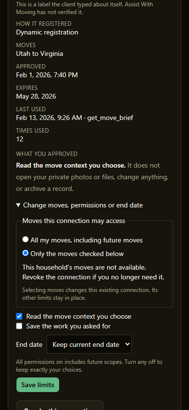
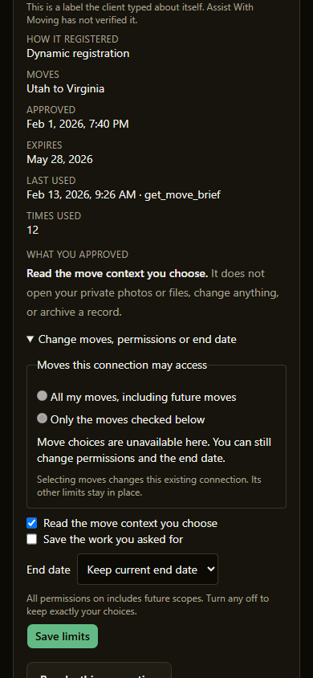

# PR #234 review repair proof

2026-11-01. Review baseline: `2497fdba96a17b4114c646f3fc83378988523431`.
Merged the 16 missing `origin/main` commits normally in `d3871c8` before repairs.

The settings form now sends move fields only after an actual change. An
unavailable or loading move picker cannot submit fields. Participant-only
owners can therefore save permissions and end dates without a household-level
move edit. Returning to the original selection also preserves the move limit.

Self-reduction validates each requested move through the existing effective
move-access resolver. This includes other active household memberships and
move-only participation, while refusing unreachable and archived moves. The
existing subset, version, calling-connection and atomic audit rules remain.
The `llms.txt` wording now names entitlement and preservation of chosen limits.
No review finding was declined.

## Regression proof

Before the implementation, this command failed with **6 failed / 79 passed**:

```text
npm run test -- tests/unit/ai-connection-manager-component.test.tsx tests/unit/mcp-legacy-grant-lifecycle.test.ts --maxWorkers=2
```

Four form assertions caught unwanted move fields; two database tests refused
reachable moves in another household with “That move is not available in this
household.” After the implementation, the same command passed **85 / 85**.
Two additional form cases cover changed selected moves and reverting a change.
Database coverage also proves participant-only permission/end-date saves and
atomic rejection of an unreachable sibling move.

Final focused result: **87 passed** across both files, on Node `v24.20.0`.

| Command | Local result |
| --- | --- |
| `npm run lint` | Pass; one existing `image-worker.js` export warning |
| `npm run typecheck` | Pass |
| `npm run build` | Pass |
| `npm run check:convex-bindings-fresh` | Pass; 151 modules |
| `npm run contract:drift` | Pass; 28 routes / 7 enum baselines |
| `npm run test -- --maxWorkers=2` | Fails in the unchanged media symlink fixture on Windows |

The isolated reproduction is:

```text
npm run test -- tests/unit/mcp-media-ingress.test.ts -t "allows only regular files" --maxWorkers=1
```

Windows refuses the fixture's `symlink(...)` with `EPERM` at line 141, before
application assertions. That test and `mcp-server/media-ingress.mjs` match
`origin/main`. Changing unrelated media code or host security settings is
outside this repair. The full-suite acceptance gate remains blocked here;
hosted Required CI is also unverified while the PR is draft.

## Phone-size component proof

Both images are **390×844**. They use the real before/after component and project
Tailwind styles, rendered with the existing unit-test mocks in a headless Edge
browser. The synthetic fixture represents a participant with no household
membership. These are component screenshots, not an authenticated live account
or deployed-backend proof. Authenticated settings-flow proof is **missing**.

| Before | After |
| --- | --- |
|  |  |

SCREEN-CHANGE: yes. Convex schema field/table deletions: no (unchanged by this
repair; the PR's earlier schema fields are additive and optional).
Risk: **TIER 2**, because this changes connection-limit submission and
authorization checks for self-reduction. No deploy, migration, backfill, or
production data write was performed. The PR stays draft for the Ship Crew gates.
